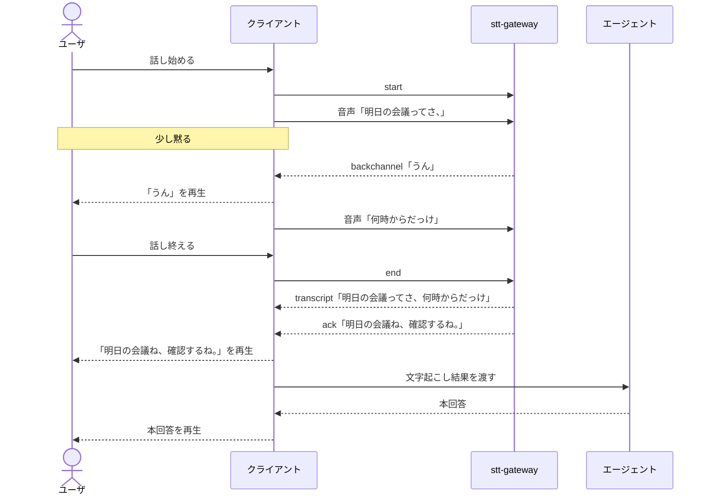

# stt-gateway

音声を文字起こしして返す API サーバ。ストリーミングでは、話している最中の相槌と、話し終えた直後の一時的な返事も返す。

## 主な機能

- **ファイルの文字起こし**（`POST /transcribe`）: 音声ファイル（WAV / Opus）を送ると、文字起こし結果を JSON で返す
- **ストリーミングの文字起こし**（WebSocket `/stream`）: 話しながら音声を送ると、次の 3 つを順に返す
  - **相槌**: 話の切れ目で「うん」「なるほど」などを返す。言いかけの途中では出さないようにもできる
  - **文字起こし結果**: 話し終えたら、その発話の文字起こし結果を返す
  - **一時的な返事**: 「〇〇ね、確認するね。」のような一言を返す。本回答が届くまでのつなぎに使う
- **文字起こしエンジンの選択**: faster-whisper（多言語）と Haas-ja（日本語専用）のどちらかを使う
- **Bearer トークンによる認証**
- **複数のワーカー**による同時処理

## 使用技術・必要な環境

| 用途 | 使用技術 | 必要な環境 |
|---|---|---|
| サーバ本体 | Python・FastAPI・uvicorn | Python 3.10 以上、[uv](https://docs.astral.sh/uv/) |
| 文字起こし（whisper） | faster-whisper（既定は `large-v3-turbo`） | GPU を使う場合は NVIDIA ドライバ |
| 文字起こし（haas） | Haas-ja（NeMo） | Python 3.11 以上、Linux、NVIDIA GPU（CPU では動かない）、追加のディスク約 8GB |
| 相槌のタイミング | Silero VAD | CPU で動く |
| 言いかけの判定（任意） | Hugging Face の言語モデル（例: `Qwen/Qwen3.5-0.8B-Base`） | NVIDIA GPU（約 1.5GB） |
| 一時的な返事 | [Ollama](https://ollama.com/)（既定は `gemma4:e2b`） | NVIDIA GPU（約 1.7GB） |

GPU メモリはワーカーごとに必要になる（文字起こしのモデルは haas で 1 ワーカーあたり最大約 3.6GB）。

## 使い方

ここでは最小の例だけを示す。リクエスト・イベント・エラーの仕様は [docs/basic-design.md](docs/basic-design.md) の「2. 外部仕様」を参照。

### 使用例: 音声エージェントの前段として使う

ユーザが話している間は相槌でつなぎ、話し終えたら文字起こし結果をエージェントに渡す。本回答ができるまでの間は、一時的な返事を読み上げて待たせる。



- 相槌は `start` から `end` の間だけ届く。
- `ack` は必ず `transcript` の後に届く。
- エージェントの呼び出しと音声の再生は、クライアントが行う。

### 動作確認（認証不要）

```bash
curl http://127.0.0.1:23000/health
```

### ファイルを文字起こしする

```bash
curl -X POST http://127.0.0.1:23000/transcribe \
  -H "Authorization: Bearer YOUR_TOKEN" \
  -F "file=@sample.opus" \
  -F "language=ja"
```

```json
{"ok": true, "text": "こんにちは", "language": "ja", "duration": 1.23,
 "latency_ms": 240, "backend": "whisper", "model": "large-v3-turbo"}
```

- 対応する拡張子は `.wav` / `.ogg` / `.opus` / `.webm`。拡張子が無い場合は `.wav` として扱う。
- `language` を省略すると `STT_LANGUAGE` を使う。haas では `ja` しか指定できない。
- `latency_ms` には、ほかのリクエストの処理を待った時間も含まれる。

### ストリーミングで文字起こしする

1 つの接続で、`start` → 音声（バイナリ）→ `end` を発話ごとに繰り返す。

```python
import asyncio, json
import websockets

async def main(opus_packets: list[bytes]) -> None:
    headers = {"Authorization": "Bearer YOUR_TOKEN"}
    async with websockets.connect("ws://127.0.0.1:23000/stream", additional_headers=headers) as ws:
        await ws.send(json.dumps({"type": "start", "encoding": "opus"}))
        for packet in opus_packets:  # マイクからエンコードした Opus のパケットを 1 つずつ
            await ws.send(packet)
        await ws.send(json.dumps({"type": "end"}))
        async for message in ws:
            event = json.loads(message)
            print(event)  # started → backchannel（話している間）→ transcript → ack の順に届く
            if event["type"] in ("ack", "error"):
                break
```

- 音声は Opus のパケット（コンテナなし・モノラル）か、16kHz・モノラル・16bit の PCM（`"encoding": "pcm_s16le"`）で送る。
- 言語は `ja` だけに対応する。
- ブラウザの WebSocket は `Authorization` ヘッダを付けられないため、ブラウザからは直接つなげない。
- 一時的な返事や相槌の言い方は、`start` に `ack`・`backchannel` を付けると発話ごとに変えられる。`"ack": false` にすると一時的な返事を返さない。
- ワーカーが入れ替わるとき（`STT_MAX_REQUESTS`）は、接続がクローズコード `1012` で切れる。接続し直す。

## セットアップ手順

### 1. 基本（whisper で文字起こしする）

```bash
uv sync
cp .env.example .env   # STT_API_KEY などを設定する
bash scripts/run_server.sh
```

モデルは起動時に読み込む。初回は Hugging Face Hub からダウンロードして `~/.cache/huggingface` に保存する（`large-v3-turbo` は約 1.6GB）。読み込みが終わるまで、リクエストは応答を待たされる。

### 2. 機能を追加する（任意）

使う機能の extras を**まとめて**指定して `uv sync` する。`uv sync` は、指定しなかった extras を削除する。

| 追加する機能 | extras | ほかに必要な作業 |
|---|---|---|
| Haas-ja で文字起こしする | `haas` | `.env` で `STT_BACKEND=haas` にする |
| `/stream` で相槌を出す | `stream` | なし |
| 言いかけの途中で相槌を出さない | `haas` と `stream` | `.env` で `STT_BACKCHANNEL_BOUNDARY_MODEL` を設定する |
| `/stream` で一時的な返事を作る | なし | Ollama を動かし、`ollama pull gemma4:e2b` でモデルを用意する |

例: すべての機能を使う場合

```bash
uv sync --extra haas --extra stream
ollama pull gemma4:e2b
```

- extras `stream` が無くても `/stream` は使えるが、相槌は出ない。
- Ollama が動いていなくても `/stream` は使えるが、一時的な返事は `STT_ACK_FALLBACK_TEXT` の固定の文言になる。

### 3. systemd で常駐させる

```bash
sudo cp stt-gateway.service /etc/systemd/system/
sudo systemctl daemon-reload
sudo systemctl enable --now stt-gateway
sudo journalctl -u stt-gateway -f
```

`stt-gateway.service` は配置先を `/opt/stt-gateway` としている。別の場所に置く場合は `WorkingDirectory` と `EnvironmentFile` を書き換える。`.env` を変えたら `sudo systemctl restart stt-gateway` で反映する。

## 環境変数・設定

`.env` に書く。範囲外の値を書くと、サーバは起動しない。

### サーバ

| 変数 | デフォルト | 説明 |
|---|---|---|
| `STT_HOST` | `0.0.0.0` | バインドするアドレス |
| `STT_PORT` | `23000` | ポート |
| `STT_API_KEY` | (空) | Bearer トークン。空の場合はトークンの値を検証しない（ヘッダは必要） |
| `STT_WORKERS` | `1` | ワーカープロセス数（同時に文字起こしできる件数） |
| `STT_MAX_REQUESTS` | `0` | 1 ワーカーがこの件数（`/health` を含む）を処理したら、ワーカーを起動し直す。`0` で無効 |
| `STT_MAX_REQUESTS_JITTER` | `0` | 起動し直すまでの件数を、ワーカーごとに 0〜この値だけずらす |

- `STT_WORKERS` を超えたリクエストは、エラーにならず空いたワーカーを待つ。
- `STT_WORKERS=1` で `STT_MAX_REQUESTS` を使う場合は、systemd で常駐させる。`scripts/run_server.sh` を直接実行していると、指定した件数でサーバが終了したままになる。

### 文字起こし

| 変数 | デフォルト | 説明 |
|---|---|---|
| `STT_BACKEND` | `whisper` | 文字起こしエンジン。`whisper` / `haas` |
| `STT_LANGUAGE` | `ja` | `language` を省略したときの言語 |
| `STT_MODEL` | `large-v3-turbo` | faster-whisper のモデル名（whisper のみ） |
| `STT_DEVICE` | `auto` | `auto` / `cuda` / `cpu`（whisper のみ） |
| `STT_COMPUTE_TYPE` | `int8_float16` | `int8` / `int8_float16` / `float16` / `float32`（whisper のみ） |
| `STT_HAAS_MODEL` | `third-intelligence/Haas-ja-v1.0` | Haas-ja のモデル（haas のみ） |

### ストリーミング（`/stream`）

| 変数 | デフォルト | 説明 |
|---|---|---|
| `STT_STREAM_MAX_UTTERANCE_SECONDS` | `60` | 1 発話の音声の上限（秒） |
| `STT_STREAM_RECORDING_DIR` | (空) | 指定すると、相槌を出した発話ごとに音声（`.wav`）と相槌の判定の記録（`.json`）を保存する。保存したファイルは自動では消えない |

### 相槌

相槌は、話し手が `STT_BACKCHANNEL_SILENCE_MS` 黙ったところで出す。話が長くなるほど、相槌を重ねるほど、相槌どうしの間隔を広げる。

| 変数 | デフォルト | 説明 |
|---|---|---|
| `STT_BACKCHANNEL_PHRASES` | `うん,うんうん,はい,なるほど` | 相槌の文言（カンマ区切り）。順に使う |
| `STT_BACKCHANNEL_SILENCE_MS` | `90` | 相槌を出すまでに待つ無音の長さ（ミリ秒、32 以上） |
| `STT_BACKCHANNEL_MIN_NEW_SPEECH_MS` | `1000` | 前の相槌（無ければ話し始め）から新しくこの長さ（ミリ秒）話すまで、相槌を出さない |
| `STT_BACKCHANNEL_MIN_INTERVAL_MS` | `1500` | 話し始めの、相槌と相槌の最短の間隔（ミリ秒） |
| `STT_BACKCHANNEL_INTERVAL_PER_MINUTE_MS` | `3000` | 1 分話すごとに、最短の間隔へ足す長さ（ミリ秒） |
| `STT_BACKCHANNEL_INTERVAL_FACTOR` | `1.1` | 相槌を 1 回出すごとに、最短の間隔を何倍にするか（1.0〜3.0） |
| `STT_BACKCHANNEL_MAX_INTERVAL_MS` | `8000` | 広げた最短の間隔の上限（ミリ秒） |
| `STT_BACKCHANNEL_BOUNDARY_MODEL` | (空) | 言いかけの途中で相槌を出さないために使う言語モデル（Hugging Face のモデル名か、モデルのディレクトリ）。空なら判定しない |
| `STT_BACKCHANNEL_BOUNDARY_THRESHOLD` | `0.35` | 相槌を出す「言い終わりらしさ」の下限（0〜1）。大きいほど相槌が減る。`0` で判定しない |
| `STT_BACKCHANNEL_JUDGE_TIMEOUT_MS` | `200` | 言いかけの判定を待つ上限（ミリ秒）。間に合わなければ、その相槌は出さない |
| `STT_BACKCHANNEL_MAX_SESSIONS` | `4` | 1 ワーカーで同時に相槌を出せる発話の数。超えた発話は相槌なしになる |

- `STT_BACKCHANNEL_BOUNDARY_MODEL` には、gateway の実行ユーザーが読める場所を指定する。Hugging Face のモデル名を指定した場合は、最初の起動時にダウンロードする。設定すると、相槌の数はおおむね半分以下に減る（例: `Qwen/Qwen3.5-0.8B-Base`）。

### 一時的な返事

| 変数 | デフォルト | 説明 |
|---|---|---|
| `STT_ACK_OLLAMA_URL` | `http://127.0.0.1:11434` | Ollama の URL |
| `STT_ACK_MODEL` | `gemma4:e2b` | 一時的な返事を作る Ollama のモデル |
| `STT_ACK_TIMEOUT_MS` | `1500` | 一時的な返事を待つ上限（ミリ秒） |
| `STT_ACK_MAX_CHARS` | `20` | 一時的な返事の文字数の上限 |
| `STT_ACK_FALLBACK_TEXT` | `ちょっと確認するね。` | 一時的な返事を作れなかったときに返す文言 |
| `STT_ACK_KEEP_ALIVE` | `30m` | Ollama がモデルを GPU に置いておく時間（Ollama の `keep_alive` の書式） |
| `STT_ACK_LOAD_TIMEOUT_MS` | `60000` | Ollama にモデルを読み込ませるときに待つ上限（ミリ秒） |

- モデルが GPU から外れていると、外れた後の最初の発話では、一時的な返事が `STT_ACK_FALLBACK_TEXT` になることがある（`gemma4:e2b` の読み込みに約 8〜15 秒かかる）。次の発話からは LLM の返事に戻る。

## ライセンス

[MIT License](LICENSE)
